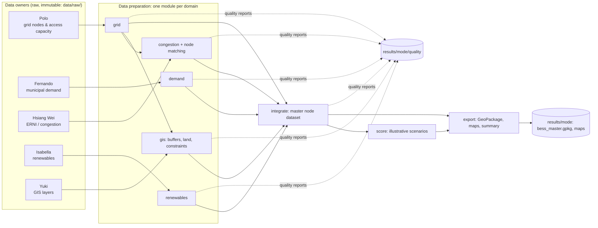

# Catalonia Grid-Scale BESS Opportunity Map

A reproducible, GIS-based **opportunity-screening** framework that identifies and prioritises
electricity-grid nodes in Catalonia (Spain) — and the land around them — that look promising
for grid-scale **Battery Energy Storage Systems (BESS)**.

University project for *Data-Driven Challenges for Energy Engineering* (UPC – ETSEIB,
2026-27), five-person team. Version **0.1.0** — software foundation complete and tested on
**synthetic** data; real datasets are being collected (see [Project status](#k-project-status-and-next-steps)).

> **Important.** The output is a *screening* model. It does not establish connection capacity,
> permitting approval, buildability, economics or profitability for any site.
> Everything under `results/demo/` is **synthetic and fictional**.

---

## Contents

A. [Project overview](#a-project-overview) ·
B. [Research methodology](#b-research-methodology) ·
C. [System architecture](#c-system-architecture) ·
D. [Team and responsibilities](#d-team-and-responsibilities) ·
E. [Project plan and milestones](#e-project-plan-and-milestones) ·
F. [Data sources](#f-data-sources) ·
G. [Installation and getting started](#g-installation-and-getting-started) ·
H. [Repository structure](#h-repository-structure) ·
I. [Data contracts and integration](#i-data-contracts-and-integration) ·
J. [Methodology limitations](#j-methodology-limitations) ·
K. [Project status and next steps](#k-project-status-and-next-steps) ·
L. [Documentation and changelog](#l-documentation-and-changelog)

---

## A. Project overview

**Research question.** *Which grid nodes and surrounding areas in Catalonia appear most
promising for grid-scale BESS when considering electrical-grid access, congestion, renewable
generation, electricity demand, physical land feasibility, environmental constraints and
accessibility?*

**Why BESS location matters.** Batteries create the most value where the grid is under
stress: where renewable output is curtailed because the network cannot absorb it, where
connection capacity is scarce, or where demand needs local support. A battery in the wrong
place adds little; in the right place it can unlock renewable energy, defer network
reinforcement and improve reliability. Location is constrained twice — *electrically*
(a node with usable access capacity) and *physically* (buildable land nearby, outside
protected or flood-prone areas, reachable by road).

**Why Catalonia.** Catalonia has ambitious renewable targets, a growing solar and wind
pipeline, reported non-integrated renewable energy (ERNI / curtailment), and open data from
REE, e-distribución, ICAEN, ICGC, Idescat and the Generalitat. That combination makes a
transparent, data-driven screening feasible.

**What the map shows.** A ranked set of grid nodes, each with grid-access, congestion,
renewable, demand and land-feasibility indicators, under several scenarios; plus maps of the
candidate areas around the best-ranked nodes for case studies.

**Who might benefit.** Storage developers and investors (early site screening), grid and
energy planners, municipalities and regional government, researchers, and the public
(transparency on where storage could help integrate renewables).

**Screening vs. engineering feasibility.** Screening uses public, partly proxy data to
*narrow down* where to look. Engineering feasibility requires the network operator's
connection studies, detailed site surveys, permitting and a business case. This project does
the former only.

## B. Research methodology

The approach is **grid opportunity → surrounding land feasibility → candidate areas**.
The analytical unit is the **grid node**, not an arbitrary land parcel: a battery is only
useful if it can connect, so we start from the network and ask where around it a battery
could physically go. Starting from land would produce a suitability heat-map that ignores
the binding electrical constraint.

1. **Identify grid nodes** — transmission (REE) and distribution (e-distribución) nodes with
   identifiers and coordinates.
2. **Gather electrical and energy indicators** — access capacity (generation and demand),
   ERNI / curtailment, renewable installations and pipeline, municipal demand.
3. **Standardise and integrate** — common identifiers (`node_id`), CRS (EPSG:25831), units,
   explicit missing values, auditable node matching.
4. **Calculate geographic metrics around nodes** — 5 / 10 / 20 km buffers.
5. **Apply development-feasibility constraints** — suitable land cover minus hard
   constraints (protected areas, flood zones, excluded zoning); accessibility.
6. **Explore the indicators** — distributions, correlations, data quality (notebooks).
7. **Build interpretable rankings** — normalised indicators, explicit weights, three
   scenarios: *renewable absorption*, *connection readiness*, *load & grid support*.
8. **Evaluate results and limitations** — data quality, ranking stability (sensitivity, later).
9. **Prepare final maps, analysis and reports** — case studies, business perspective.

Details and formulas: [docs/methodology.md](docs/methodology.md). Assumptions:
[docs/assumptions.md](docs/assumptions.md).

# C. System architecture



* **Data preparation** (`grid`, `demand`, `congestion`, `renewables`, `gis`) turns each
  source into a standardised, validated dataset with a quality report.
* **Integration** (`integrate`) joins everything onto the canonical grid nodes.
* **Analysis** (`score`) is separate from preparation and fully configurable.
* **ML** (`ml`) trains a Random Forest to identify opportunity nodes by learning from existing renewable developer siting decisions (optional, requires `integrate` + `renewables`).
* **Presentation** (`export`) writes the GeoPackage, tables, maps and a run summary.

Stage names and order: `grid`, `demand`, `congestion`, `renewables`, `gis`, `integrate`,
`score`, `ml`, `export`. Full design: [docs/architecture.md](docs/architecture.md).

## D. Team and responsibilities

| Member                      | Domain      | Data sources                                                                                     | Expected outputs                                                                                | Depends on                      | Integration responsibilities                                                                    |
| --------------------------- | ----------- | ------------------------------------------------------------------------------------------------ | ----------------------------------------------------------------------------------------------- | ------------------------------- | ----------------------------------------------------------------------------------------------- |
| **Polo**              | Grid nodes  | REE access capacity (transmission); e-distribución capacity (distribution)                      | `grid_nodes`: ids, names, **coordinates**, voltage, generation & demand access capacity | — (everyone depends on Polo)   | Owns the canonical `node_id`; keeps source ids; resolves duplicate nodes                      |
| **Fernando**          | Demand      | ICAEN / Idescat municipal electricity consumption by sector; industrial demand                   | `demand_municipal` long table + municipal summary                                             | Yuki (municipal boundaries)     | Preserves original geographic and temporal resolution; flags suppressed values                  |
| **Hsiang Wei**        | Congestion  | REE / ESIOS ERNI, curtailment, constraint indicators                                             | ERNI records, `node_matching`, 12-month ERNI per node                                         | Polo (node list)                | Preserves original congestion ids; maintains the reviewed crosswalk; resolves ambiguous matches |
| **Isabella**          | Renewables  | Generalitat (ICAEN) installations; environmental viewer for planned projects                     | Installations with **coordinates**, capacity, technology, status (operating vs pipeline)  | —                              | Validates coordinates; maintains the status mapping                                             |
| **Yuki**              | GIS         | ICGC land cover & DTM, MUC zoning, protected areas, ACA flood zones, roads, municipal boundaries | Node metrics: suitable land, constraint shares, conflicts, road distance; maps                  | Polo (nodes), Isabella (points) | CRS standards, spatial aggregation, map generation, GIS validation                              |
| *Integration coordinator* | Integration | Processed outputs of all domains                                                                 | `nodes_integrated`, scores, master GeoPackage                                                 | Everyone                        | **To be designated by the team.** Reviews shared-schema, integration and scoring PRs      |

Grid-node coordinates come **only** from Polo and renewable-installation coordinates **only**
from Isabella; nobody collects the same coordinate dataset twice unless validation shows a
need. How to work independently: [docs/team_workflow.md](docs/team_workflow.md).

## E. Project plan and milestones

**Confirmed course milestones** (course introduction slides, 10 Sep 2026):

| Milestone                                       | Group 1                  | Group 2               | Content                                                                       |
| ----------------------------------------------- | ------------------------ | --------------------- | ----------------------------------------------------------------------------- |
| Conceptual proposal (session 3)                 | 1 Oct 2026               | 2 Oct 2026            | 5 min: idea, dataset exploration, mini value proposition                      |
| **Intermediate presentation** (session 7) | **5 Nov 2026**     | **6 Nov 2026**  | 15 min: data-driven results, updated concept, track decision, roles, plan     |
| **Final presentation** (session 13)       | **17 Dec 2026**    | **18 Dec 2026** | 30 min: whole project, technical scope and business case; all members present |
| Final report                                    | not stated in the slides |                       | Complete project report                                                       |

No classes on 29–30 Oct 2026 (exam period). Technological track: sessions 3–7; innovation /
business track: sessions 8–12.

**Phases** — internal timing is a *proposed working target*, not an agreed deadline:

| Phase                         | Goal                                      | Deliverables                                                              | Depends on               | Done when                                                         | Responsible                   | Course link            |
| ----------------------------- | ----------------------------------------- | ------------------------------------------------------------------------- | ------------------------ | ----------------------------------------------------------------- | ----------------------------- | ---------------------- |
| 1. Foundation                 | Shared environment, pipeline, contracts   | This repository v0.1.0                                                    | —                       | Demo runs end-to-end, tests pass                                  | Yuki (setup), all (review)    | Technological track    |
| 2. Data acquisition           | Collect and document real sources         | Raw files in `data/raw/`, entries in `config/datasets.yaml`, manifest | Phase 1                  | Each domain's `--validate` passes                               | Each data owner               | Before intermediate    |
| 3. Integration M1             | Grid coordinates + access capacity + ERNI | `nodes_integrated` (M1)                                                 | Polo, Hsiang Wei         | Matching report reviewed; no unresolved ambiguities for key nodes | Polo, Hsiang Wei, coordinator | Intermediate (5/6 Nov) |
| 4. Integration M2–M3         | Add renewables, demand, land feasibility  | `nodes_integrated` (M3)                                                 | Isabella, Fernando, Yuki | All five domains integrated                                       | All                           | After intermediate     |
| 5. Exploration & scoring      | Justify indicators and weights            | Updated `scoring.yaml`, notebooks                                       | Phase 4                  | Choices recorded in `docs/decisions.md`                         | Team                          | —                     |
| 6. Sensitivity & case studies | Ranking stability, candidate areas        | Sensitivity results, case-study maps                                      | Phase 5                  | Top candidates robust or caveated                                 | Team                          | —                     |
| 7. Business & final           | Innovation track, report, slides          | Business case, final report, presentation                                 | Phases 5–6              | Submitted                                                         | All                           | Final (17/18 Dec)      |

**Progress** (verified repository facts only; detailed tasks live in Notion):

| Workstream              | Owner                | Current status                                                                                        | Next deliverable                                                | Known blockers                                                      |
| ----------------------- | -------------------- | ----------------------------------------------------------------------------------------------------- | --------------------------------------------------------------- | ------------------------------------------------------------------- |
| Framework & tooling     | Yuki                 | v0.1.0 implemented; test suite passes on synthetic data                                               | Team onboarding                                                 | —                                                                  |
| Grid                    | Polo                 | Module implemented; no real data in the repository yet                                                | Access-capacity file + column mapping                           | Source format to confirm                                            |
| Demand                  | Fernando             | Module implemented; a local ICAEN-format file (2013–2024, 947 municipalities) processes in real mode | Confirm source URL and publication date                         | Provenance not yet verified; spatial use needs municipal boundaries |
| Congestion              | Hsiang Wei           | Module and node matching implemented; no real data yet                                                | ERNI file + crosswalk                                           | —                                                                  |
| Renewables              | Isabella             | Module implemented; no real data yet                                                                  | Installation file + status mapping                              | —                                                                  |
| GIS                     | Yuki                 | Module implemented; no real layers yet                                                                | Land cover, protected areas, flood zones, roads, municipalities | Layer sizes / formats to decide                                     |
| Integration coordinator | *to be designated* | —                                                                                                    | Designate coordinator                                           | —                                                                  |

## F. Data sources

| Source organisation                 | Category                                    | Owner           | Expected format     | Intended use                                      | Status                                   |
| ----------------------------------- | ------------------------------------------- | --------------- | ------------------- | ------------------------------------------------- | ---------------------------------------- |
| REE (Red Eléctrica)                | Transmission access capacity                | Polo            | CSV / XLSX          | Generation & demand access capacity per node      | investigating                            |
| e-distribución                     | Distribution access capacity                | Polo            | CSV / XLSX          | Node capacity (distribution)                      | investigating                            |
| REE / ESIOS                         | ERNI, curtailment                           | Hsiang Wei      | CSV / XLSX          | Congestion indicator                              | investigating                            |
| Generalitat de Catalunya – ICAEN   | Existing renewable installations            | Isabella        | CSV / JSON          | Operating capacity near nodes                     | investigating                            |
| Generalitat – environmental viewer | Planned renewable / battery projects        | Isabella        | GIS / CSV           | Development pipeline                              | investigating                            |
| ICAEN via Dades Obertes / Idescat   | Municipal electricity consumption by sector | Fernando        | CSV                 | Local demand context                              | **file in hand, source to verify** |
| ICGC                                | Land cover; terrain (DTM)                   | Yuki            | SHP / GPKG / raster | Suitable land; slope (later)                      | investigating                            |
| Generalitat – MUC                  | Urban planning / zoning                     | Yuki            | SHP / GML           | Zoning exclusions                                 | investigating                            |
| MITECO / Generalitat                | Protected areas (Natura 2000, PEIN)         | Yuki            | SHP / GeoJSON       | Hard constraint                                   | investigating                            |
| Agència Catalana de l'Aigua        | Flood zones                                 | Yuki            | SHP / WMS           | Hard constraint                                   | investigating                            |
| Generalitat / ICGC                  | Roads                                       | Yuki            | SHP                 | Accessibility                                     | investigating                            |
| ICGC / Idescat                      | Municipal boundaries; population            | Yuki / Fernando | SHP / CSV           | Spatial demand allocation; social context (later) | investigating                            |

"Investigating" = identified in project planning, not yet downloaded and verified. Always use
the newest official publication at the time of retrieval and record its dates. Detailed
records: [docs/dataset_inventory.md](docs/dataset_inventory.md).

## G. Installation and getting started

**Prerequisites:** [git](https://git-scm.com/) and **uv** (manages Python 3.12 and the
project's `.venv`; you never install packages or activate environments manually). QGIS
(optional, separate desktop install) to inspect maps.

**1. Install uv once** (official instructions:
[https://docs.astral.sh/uv/getting-started/installation/](https://docs.astral.sh/uv/getting-started/installation/)):

| OS                                 | Command                                             |
| ---------------------------------- | --------------------------------------------------- |
| macOS (Homebrew)                   | `brew install uv`                                 |
| macOS / Linux (official installer) | `curl -LsSf https://astral.sh/uv/install.sh \| sh` |
| Windows                            | `winget install --id=astral-sh.uv -e`             |

Open a new terminal afterwards. The start scripts never download installers themselves; if
uv is missing they stop with these instructions.

**2. Clone** — outside iCloud / OneDrive / Dropbox-synced folders (syncing interferes with
`.venv`, see [Troubleshooting](#troubleshooting)):

```bash
git clone https://github.com/yainge/bess-opportunity-map-ddc.git
cd bess-opportunity-map-ddc
```

**3. Initialise the environment** — creates `.venv` from `uv.lock` (uv downloads Python 3.12
if needed) and checks the folders:

```bash
./start.sh --setup
```

Windows (PowerShell): `.\start.ps1 --setup`. If scripts are blocked:
`powershell -ExecutionPolicy Bypass -File .\start.ps1 --setup`. Every command below works the
same with `.\start.ps1` in place of `./start.sh`.

**4. Run the synthetic demonstration:**

```bash
./start.sh --mode demo --all
```

This generates fictional inputs in `data/sample/` (first time only) and runs all eight stages.
Results: `results/demo/` — `bess_master.gpkg`, `maps/*.png`, `summary.md`, `quality/*.md`.

**Command reference**

```bash
./start.sh --help                                # all options
./start.sh --setup                               # check / initialise the environment
./start.sh --mode demo --all                     # synthetic end-to-end demonstration
./start.sh --mode real --steps grid              # one stage
./start.sh --mode real --steps demand
./start.sh --mode real --steps congestion
./start.sh --mode real --steps renewables
./start.sh --mode real --steps gis
./start.sh --mode real --steps grid,congestion   # several stages (run in dependency order)
./start.sh --mode real --steps integrate         # integrate whatever processed outputs exist
./start.sh --mode real --steps score             # scoring (needs integrate output)
./start.sh --mode real --all                     # all stages; optional ones skipped if no data
./start.sh --mode real --validate                # validate available inputs, write quality reports
./start.sh --mode real --all --dry-run           # show the plan; execute and write nothing
./start.sh --mode real --steps grid --force      # re-run even if up to date
./start.sh --mode real --record-manifest         # record checksums of the current input files
./start.sh --lab                                 # JupyterLab on notebooks/
./start.sh --test                                # run the test suite
```

Behaviour:

* `--mode` is required for pipeline commands; demo and real data never share folders.
* **Up-to-date detection:** a stage is skipped ("up to date") when its input files, relevant
  configuration, upstream outputs and code are unchanged; `--force` overrides.
* **Missing data:** a stage requested with `--steps` whose data is missing is an **error**
  (exit code 1) naming the expected file. With `--all`, `demand`, `congestion`, `renewables`
  `gis`, and `ml` are *optional* — skipped and reported; `grid`, `integrate`, `score` and `export`
  are required. Real mode never falls back to synthetic data.
* A stage can run on its own when its upstream outputs already exist (e.g. `--steps congestion` reuses an earlier `grid` output); otherwise it names the stage to run first.
* `--dry-run` prints WOULD RUN / UP TO DATE / SKIP / BLOCKED per stage with its input files.
* Exit codes: `0` success, `1` a stage failed or was blocked, `2` invalid usage or
  configuration, `127` uv not installed.
* Every run writes `logs/<run_id>.log` and a run record `logs/runs/<run_id>.json`.

**Open results in QGIS:** *Layer → Add Layer → Add Vector Layer…*, choose
`results/demo/bess_master.gpkg` (or `results/real/…`) and add all layers. Details:
[qgis/README.md](qgis/README.md).

**Tests:** `./start.sh --test`. Quick unit tests only: `./start.sh --test -m "not slow"`.

**Notebooks:** `./start.sh --lab` opens JupyterLab with the project's environment (extra arguments such as `--port 8890` are passed on to JupyterLab). The three
notebooks in `notebooks/` run on the synthetic demo out of the box. Use them to *explore* data
and methods; logic worth keeping moves into `src/bess_catalonia/`. Clear outputs before
committing (*Edit → Clear Outputs of All Cells*).

### Troubleshooting

* **`No module named bess_catalonia`** when running Python directly on macOS: files in
  iCloud-synced folders can get a "hidden" flag, and Python 3.12 skips hidden `.pth` files.
  The start scripts work around it; keeping the clone outside synced folders avoids it.
* **`uv sync` fails because the lockfile needs updating:** someone edited `pyproject.toml`
  without committing `uv.lock`. Run `uv lock` and commit the lockfile.

## H. Repository structure

| Path                                 | Purpose                                                                                                                                                                     |
| ------------------------------------ | --------------------------------------------------------------------------------------------------------------------------------------------------------------------------- |
| `start.sh`, `start.ps1`          | Entry points: bootstrap `.venv`, forward to the CLI                                                                                                                       |
| `config/`                          | `project.yaml` (paths, modes, rules), `datasets.yaml` (inputs, mappings, provenance), `spatial.yaml` (buffers, constraints), `scoring.yaml` (indicators, scenarios) |
| `src/bess_catalonia/`              | Python package: core (`cli`, `config`, `pipeline`, `schemas`, `quality`, `provenance`, `io`, `units`, `demo`) and one sub-package per stage               |
| `data/raw/<domain>/`               | Official source files — immutable, **not in git** (share via the team drive)                                                                                         |
| `data/processed/`                  | Reproducible real-mode outputs per stage (not in git)                                                                                                                       |
| `data/sample/`                     | Synthetic demo inputs (generated deterministically on the first demo run; not committed)                                                                                    |
| `data/manifests/`                  | Data-version manifests (checksums of inputs)                                                                                                                                |
| `results/demo/`, `results/real/` | GeoPackage, maps, tables, quality reports — strictly separate                                                                                                              |
| `results/reports/`                 | Hand-written analysis reports and figures for presentations                                                                                                                 |
| `notebooks/`                       | Exploration notebooks (synthetic data by default)                                                                                                                           |
| `tests/`                           | `unit/`, `integration/`, `fixtures/`                                                                                                                                  |
| `qgis/`                            | QGIS instructions (project and style files later)                                                                                                                           |
| `docs/`                            | Architecture, data contract, inventory, methodology, assumptions, decisions, workflow, future features                                                                      |
| `logs/`                            | Run logs and run records (not in git)                                                                                                                                       |

## I. Data contracts and integration

* **Canonical identifier:** `node_id = <operator>-<source_node_id>` (e.g. `REE-SYN_T01`),
  created by the grid stage. Source identifiers are always preserved (`source_node_id`,
  `source_installation_id`, `congestion_source_key`).
* **CRS:** analysis in **EPSG:25831** (metres); lon/lat **EPSG:4326** kept as columns. Each
  dataset declares its `source_crs`; the CRS stored in a file wins and conflicts are reported.
* **Units:** MW, MWh / GWh (explicit in column names), metres internally, km and ha in
  outputs. Source units are declared in `datasets.yaml` and converted explicitly.
* **Formats:** inputs CSV / XLSX / Parquet / GeoPackage / Shapefile / GeoJSON; outputs
  GeoPackage + CSV (+ Parquet). Column names are `snake_case`.
* **Missing values are null, never zero.** Scoring treats them with an explicit policy.
* **Node matching** (congestion → grid) is rule-based and auditable: reviewed crosswalk →
  identical source id → unique normalised name. Ambiguous records are never merged;
  `node_matching.csv` lists every decision.
* **Quality reports** for every dataset: `results/<mode>/quality/quality_<dataset>.md|json`.
* **Contributing a dataset:** put the file in `data/raw/<domain>/`, edit its entry under
  `real:` in `config/datasets.yaml` (path, format, `source_crs`, column mapping, units,
  provenance metadata), run `./start.sh --mode real --validate`, then `--steps <domain>`, then
  `--record-manifest`. Full contract: [docs/data_contract.md](docs/data_contract.md).

## J. Methodology limitations

* **Grid-access capacity does not guarantee a BESS connection.** Published capacity changes,
  is allocated by queue, and the operator's connection study is decisive. The headroom proxy
  `min(generation, demand)` is an indicative bidirectional screening metric only.
* **ERNI does not establish BESS profitability.** It shows renewable energy that was not
  integrated; storage revenue depends on markets, prices and regulation.
* **Geographic proximity does not prove electrical connectivity.** Installations within
  10 km of a node are not necessarily connected to it.
* **Municipal annual demand is not nodal hourly loading.** Demand is allocated to buffers by
  area share, assuming uniform demand within a municipality; suppressed values make totals
  lower bounds.
* **Suitable land is not necessarily legally developable.** Land cover and mapped constraints
  miss ownership, detailed planning rules, connection routes and local acceptance.
* **Scores reflect assumptions and source limitations.** Current weights are illustrative;
  rankings must be read with the data-quality indicators and, later, sensitivity results.

More: [docs/assumptions.md](docs/assumptions.md).

## K. Project status and next steps

**Implemented and tested (synthetic data):** environment and locking, start scripts, CLI,
configuration validation, five domain stages with validation and quality reports, auditable
node matching, spatial metrics (buffers, land, constraints, roads), area-weighted demand,
partial integration with milestone tracking, illustrative three-scenario scoring, master
GeoPackage, maps, run records, data manifests, up-to-date detection, three runnable notebooks.

**Being developed:** acquisition of real datasets by each owner (see the progress table).

**Blocked / waiting:** real grid data (blocks real integration and scoring); municipal
boundaries (blocks spatial demand); integration coordinator not yet designated.

**Next steps:** (1) each owner adds their source and mapping and runs `--validate`;
(2) M1 integration (grid + ERNI) ahead of the intermediate presentation; (3) exploratory
analysis to justify weights; (4) sensitivity analysis; (5) case studies and business case.
Deferred features: [docs/future_features.md](docs/future_features.md).

## L. Documentation and changelog

| Document                                                                         | What it records                                                      |
| -------------------------------------------------------------------------------- | -------------------------------------------------------------------- |
| [CHANGELOG.md](CHANGELOG.md)                                                      | Software, schema and methodology changes (Keep a Changelog)          |
| `data/manifests/*.json`                                                        | Exact dataset versions (checksums) — separate from the changelog    |
| `logs/runs/*.json`                                                             | What each pipeline run read and wrote — separate from the changelog |
| [docs/architecture.md](docs/architecture.md)                                      | Stages, modules, execution model                                     |
| [docs/data_contract.md](docs/data_contract.md)                                    | Every canonical column, type and unit                                |
| [docs/dataset_inventory.md](docs/dataset_inventory.md)                            | Sources, provenance, verification status                             |
| [docs/methodology.md](docs/methodology.md)                                        | Formulas and spatial methods                                         |
| [docs/assumptions.md](docs/assumptions.md), [docs/decisions.md](docs/decisions.md) | Assumptions; decision log                                            |
| [docs/team_workflow.md](docs/team_workflow.md)                                    | Branches, PRs, reviews, contributing data                            |
| [docs/future_features.md](docs/future_features.md)                                | Deliberately deferred work                                           |
| [docs/data_pipeline_overview.md](docs/data_pipeline_overview.md)                  | Data pipeline: per-domain table (dataset, source, variables, cleaning, processing, usage, outputs, status) and Mermaid flowchart |

**Keeping documentation current is part of every change.** Whenever code, architecture,
responsibilities, workflow, scope or significant progress changes, update the relevant README
section, `CHANGELOG.md` and the affected docs in the same pull request (see the
[PR checklist](.github/pull_request_template.md)). Documentation must never claim a feature
exists before it does. Running the pipeline does not change documentation.
