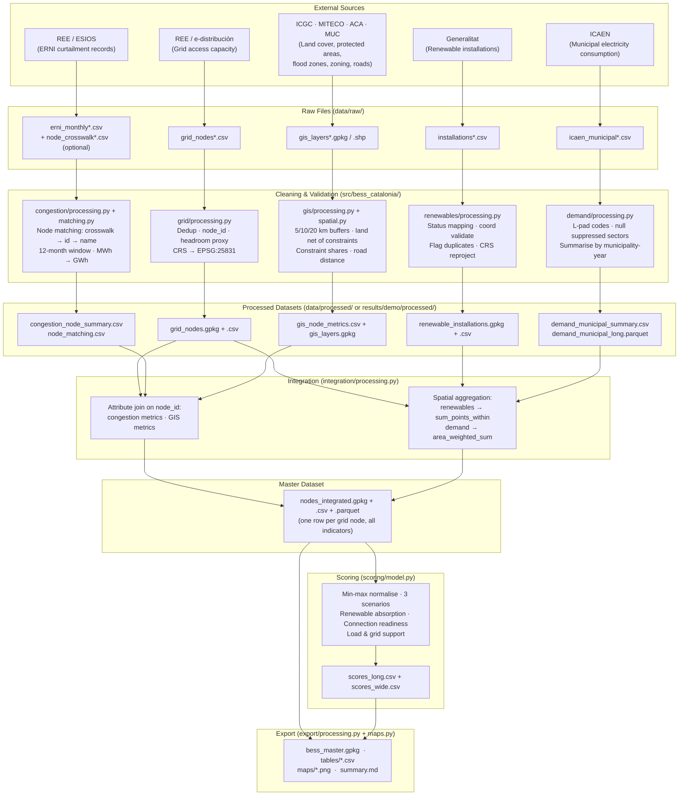

# Data Pipeline Overview

This document describes how data actually moves through the BESS Opportunity Map pipeline
— what is collected, how it is cleaned and processed, how it is integrated, and what outputs
each stage produces. It is intended as a team reference and was derived by inspecting the
source code directly (not the project specification).

**Key distinction.** All eight pipeline stages are **fully implemented and tested on synthetic
data**. The gap is real-data availability: most source files are still being collected (see the
Status row in the table below and the [blockers section](#known-gaps-and-blockers)). Running
`./start.sh --mode demo --all` exercises the complete pipeline end-to-end on fictional data.

Related docs: [architecture.md](architecture.md) · [data_contract.md](data_contract.md) ·
[dataset_inventory.md](dataset_inventory.md) · [methodology.md](methodology.md)

---

## Data Flow Diagram

The diagram below shows the full data flow from external sources through to final outputs.
Five domain lanes run in parallel through cleaning and validation, then converge at the
integration stage. Module names in the **Cleaning & Validation** boxes are the actual Python
files responsible for each operation.

---

## Per-Domain Pipeline Table

The table below covers each domain across nine attributes. Scroll horizontally if needed.
Module links are relative to the repository root. All column names follow `snake_case`;
units are explicit in column suffixes (`_mw`, `_mwh`, `_gwh`, `_km`, `_ha`).
Missing values are **null, never zero** — a design decision applied consistently across all domains.

| | **Grid Nodes & Access** | **Congestion** | **Electricity Demand** | **Renewable Generation** | **GIS / Land** |
|---|---|---|---|---|---|
| **Dataset** | Grid node list with electrical access capacity — transmission (REE) and distribution (e-distribución) nodes; geographic coordinates; generation and demand available capacity per node | ERNI (Energía Renovable No Integrada) records — monthly non-integrated renewable energy per source node; optional reviewed crosswalk table mapping congestion source IDs to canonical grid node IDs | ICAEN municipal electricity consumption — annual MWh by municipality, year, and sector (industrial, residential, services, transport, construction) for all of Catalonia | Renewable installation registry — point locations of existing and planned solar PV, wind, hydro, and biomass installations in Catalonia | Six spatial layers: land cover classification, protected areas (Natura 2000 / PEIN), flood zones (ACA), urban zoning (MUC), road network, and municipal boundaries |
| **Source** | REE (Red Eléctrica de España) for transmission nodes; e-distribución for distribution nodes — official access-capacity publications | REE / ESIOS curtailment and congestion statistics | ICAEN (Institut Català d'Energia) via Dades Obertes de Catalunya / Idescat | Generalitat de Catalunya — ICAEN installation registry; Generalitat environmental viewer for planned and authorised projects | ICGC (land cover), MITECO / Generalitat (protected areas), ACA — Agència Catalana de l'Aigua (flood zones), Generalitat MUC (zoning), ICGC / Generalitat (roads), ICGC / Idescat (municipal boundaries) |
| **Original file types** | CSV / XLSX (format to confirm with source) | CSV (ERNI records); CSV (crosswalk, optional) | CSV with Catalan number format: thousands separator `.`, decimal `,` (e.g. `2.555.460,5`) | CSV / JSON / GIS (format to confirm with Generalitat) | GeoPackage (GPKG), Shapefile (SHP), GML; raster DTM deferred to future work |
| **Variables extracted** | `source_node_id`, `node_name`, `x`, `y`, `operator`, `network_level`, `voltage_kv`, `generation_available_mw`, `demand_available_mw`, `generation_capacity_date`, `demand_capacity_date` | ERNI records: `source_node_name`, `period_start`, `erni_mwh`; optional: `source_node_id`, `network_level`. Crosswalk: source key → `source_node_id` | `municipality_code` (5-digit INE), `year`, `consumption_mwh`, `municipality_name`, `sector_code`, `sector_name`, `province`, `comarca`, `source_note` | `source_installation_id`, `capacity_mw`, `status`, `x`, `y`, `installation_name`, `technology` | `land_class` (land cover polygons); geometry (protected areas, flood zones, zoning); `road_class` (motorway / primary / secondary); `municipality_code` (boundaries) |
| **Cleaning** | Exact duplicate rows removed (warning); conflicting node IDs with differing attributes → error; negative capacities → null (warning); coordinates outside Catalonia bbox [0.10–3.40°E, 40.45–42.95°N] → dropped (error); source CRS → EPSG:25831; column names remapped via `config/datasets.yaml`. _Modules: [grid/processing.py](../src/bess_catalonia/grid/processing.py) `validate()`, [io.py](../src/bess_catalonia/io.py) `load_standardized()`_ | `period_start` → monthly period; duplicate (source_key × month × network_level) → error; negative ERNI → error; missing ERNI kept as null (never zero, warning); source node names normalised for matching: NFKD, strip accents, uppercase, remove prefix tokens "SE", "SUBESTACION", "SUBESTACIO", "ST", "SET". _Modules: [congestion/processing.py](../src/bess_catalonia/congestion/processing.py) `validate()`, [congestion/matching.py](../src/bess_catalonia/congestion/matching.py) `normalise_name()`_ | Municipality codes left-padded to 5 digits (source often strips leading zero); Catalan secrecy marker "Dada subjecta a secret estadístic" in `source_note` → `consumption_mwh = null` (flagged, never zero); duplicate (municipality × year × sector) → error; negative consumption → error; Catalan number format parsed by [io.py](../src/bess_catalonia/io.py) using `number_format` from `datasets.yaml`. _Module: [demand/processing.py](../src/bess_catalonia/demand/processing.py) `validate()`_ | Coordinates validated against Catalonia bbox: invalid → `coord_valid = False` (row kept in CSV, excluded from GPKG); duplicate `source_installation_id` → first occurrence kept, `duplicate_source_id = True` for others; unmapped `status` values → `unknown` (warning); negative `capacity_mw` → error; source CRS → EPSG:25831. _Module: [renewables/processing.py](../src/bess_catalonia/renewables/processing.py) `validate()`, `_coords_valid()`_ | All layers reprojected to EPSG:25831 on read; invalid / empty geometries repaired; features filtered to class values configured in `config/spatial.yaml`; missing class columns → error reported in quality report. _Modules: [io.py](../src/bess_catalonia/io.py) `read_vector()`, [gis/processing.py](../src/bess_catalonia/gis/processing.py) `validate()`_ |
| **Processing** | Creates canonical `node_id = <operator>-<source_node_id>` (e.g. `REE-SYN_T01`); computes `bess_headroom_proxy_mw = min(generation_available_mw, demand_available_mw)` — only when both values are non-null, non-negative, and share the same publication date; adds WGS84 `lon` / `lat` columns; sorts by `node_id`. _Module: [grid/processing.py](../src/bess_catalonia/grid/processing.py) `process()`, `headroom_proxy()`_ | **Three-tier node matching** (first match wins): (1) reviewed crosswalk — highest reliability; (2) exact `source_node_id` match — high reliability; (3) unique normalised name match — medium reliability. Ambiguous matches (multiple candidates) are **never merged** and require a crosswalk entry. Rolling 12-month window aggregation per canonical `node_id`; `erni_mwh → erni_gwh` (÷ 1 000). Every matching decision is written to `node_matching.csv`. _Modules: [congestion/matching.py](../src/bess_catalonia/congestion/matching.py) `match_nodes()`, [congestion/processing.py](../src/bess_catalonia/congestion/processing.py) `summarise()`_ | Long table kept at full source resolution (municipality × year × sector); summarised to latest year per municipality: `total_mwh` = sum of all sectors; `industrial_mwh` = sum of industrial-sector codes; `n_suppressed_sectors` = count of null sectors; `total_is_lower_bound = True` when any sector is suppressed. _Module: [demand/processing.py](../src/bess_catalonia/demand/processing.py) `summarise()`_ | Status text mapped to `status_category` (operating / pipeline / unknown) via configurable `status_map` in `datasets.yaml`; point geometries created from `x`, `y` in source CRS; rows with invalid coordinates get `geometry = None` (row retained for CSV); spatial aggregation (`sum_points_within`) is deferred to the integration stage. _Module: [renewables/processing.py](../src/bess_catalonia/renewables/processing.py) `process()`, `_categorise()`_ | Euclidean buffers at 5, 10, 20 km per node (64-segment circles, EPSG:25831); `suitable_land_ha = area(suitable land classes ∩ buffer) − area(hard constraints ∩ buffer)`, m² → ha; constraint shares = `area(constraint ∩ buffer) / buffer area`; `protected_area_conflict` = protected area within 1 km of node (bool); `flood_risk_at_node` = node inside flood zone (bool); `distance_to_major_road_km` = nearest motorway or primary road, m → km. STRtree spatial index used for efficiency. _Modules: [gis/spatial.py](../src/bess_catalonia/gis/spatial.py), [gis/processing.py](../src/bess_catalonia/gis/processing.py) `compute_node_metrics()`_ |
| **Usage in BESS model** | Backbone — all other datasets join onto these nodes. Three scoring indicators: `bess_headroom_proxy_mw` (_connection readiness_ wt 0.40, _load & grid support_ wt 0.15), `generation_available_mw` (_renewable absorption_ wt 0.15), `demand_available_mw` (_load & grid support_ wt 0.25) | `erni_12m_gwh` is the primary congestion indicator: _renewable absorption_ scenario wt 0.35, _connection readiness_ wt 0.10, _load & grid support_ wt 0.15. Evidence of where the grid cannot absorb renewable output; not a direct revenue measure. | Spatially aggregated in integration (area-weighted by municipality share within buffer) → `nearby_demand_mwh_10km` (_load & grid support_ wt 0.35) and `nearby_industrial_demand_mwh_10km` (contextual). Proxy for local demand context; **not nodal hourly load**; totals are lower bounds where sectors are suppressed. | Spatially aggregated in integration (sum of capacity within 10 km) → `renewable_mw_10km` (_renewable absorption_ wt 0.20) and `renewable_pipeline_mw_10km` (_renewable absorption_ wt 0.15). A point installation may count toward multiple overlapping node catchments — context indicator, not an electrical connection. | Three scoring indicators: `suitable_land_ha_5km` used in all three scenarios; `distance_to_major_road_km` (_connection readiness_ wt 0.20). Hard exclusion: nodes with `protected_area_conflict = True` are excluded from ranking before scoring. Municipal boundaries layer also used by the integration stage to perform the spatial demand join. |
| **Output files** | `grid_nodes.gpkg`, `grid_nodes.csv` — in `processed/grid/` | `congestion_records.csv`, `node_matching.csv`, `congestion_node_summary.csv` — in `processed/congestion/` | `demand_municipal_long.csv`, `demand_municipal_long.parquet`, `demand_municipal_summary.csv` — in `processed/demand/` | `renewable_installations.gpkg` (valid coordinates only), `renewable_installations.csv` (all records), `renewables_summary.csv` — in `processed/renewables/` | `gis_node_metrics.csv`, `gis_layers.gpkg` (layers: `node_buffers`, `suitable_land_net`, `hard_constraints`) — in `processed/gis/` |
| **Status** | ⚠️ **Partial** — stage fully implemented and tested on synthetic data; real grid data **not yet delivered** (`path: null` in `config/datasets.yaml`). Polo is investigating REE / e-distribución format. | ⚠️ **Partial** — stage and node-matching fully implemented and tested; real ERNI data **not yet delivered** (`path: null`). Crosswalk CSV template is ready for population. | ⚠️ **Partial** — stage fully implemented; ICAEN-format file present locally (`data/raw/demand/export.csv`, 2013–2024, 947 municipalities) but **provenance not yet confirmed** (status: `to_verify`). Municipal boundaries layer also needed for spatial demand integration. | ⚠️ **Partial** — stage fully implemented and tested on synthetic data; real installation data **not yet delivered** (`path: null`). Isabella is investigating the Generalitat registry format. | ⚠️ **Partial** — stage fully implemented and tested on synthetic data; **no real GIS layers yet** (all six entries have `path: null`). Layer sizes and formats still to decide. Absence of municipal boundaries also blocks the demand spatial join in integration. |

---

## Integration: Identifier Join vs Spatial Aggregation

Two distinct join mechanisms are used when assembling the master dataset. This is important
to understand when debugging or extending the pipeline.

| Upstream dataset | Join type | Key used | Implementing function |
|---|---|---|---|
| `grid_nodes` | — | Reference table; all others join onto this | [`integration/processing.py`](../src/bess_catalonia/integration/processing.py) |
| `congestion_node_summary` | **Attribute join** on `node_id` | Exact string match | [`integration/processing.py`](../src/bess_catalonia/integration/processing.py) `_join_attributes()` |
| `gis_node_metrics` | **Attribute join** on `node_id` | Exact string match | [`integration/processing.py`](../src/bess_catalonia/integration/processing.py) `_join_attributes()` |
| `renewable_installations` | **Spatial aggregation** | Sum of `capacity_mw` within 10 km of each node | [`gis/spatial.py`](../src/bess_catalonia/gis/spatial.py) `sum_points_within()` |
| `demand_municipal_summary` | **Spatial aggregation** | Area-weighted sum within 10 km, via municipality polygons | [`gis/spatial.py`](../src/bess_catalonia/gis/spatial.py) `area_weighted_sum()` |

The spatial aggregation radius (10 km default) is configured in `config/project.yaml` under
`integration.aggregation_radius_km` and can be changed without touching the code.

---

## Shared Pipeline Outputs

These files are produced by the integration, scoring, and export stages and combine
information from all domains.

| File | Location | Contents |
|---|---|---|
| `nodes_integrated.gpkg` | `processed/integrate/` | Master node GeoDataFrame — all grid nodes with all domain indicators joined |
| `nodes_integrated.csv` | `processed/integrate/` | Same as above, tabular |
| `nodes_integrated.parquet` | `processed/integrate/` | Same as above, binary (fast I/O for scoring) |
| `scores_long.csv` | `processed/score/` | One row per node × scenario: `score`, `rank`, `weight_coverage`, `missing_indicators`, `excluded_reason` |
| `scores_wide.csv` | `processed/score/` | Scores pivoted to one column per scenario (e.g. `renewable_absorption_score`, `_rank`) |
| `bess_master.gpkg` | `results/<mode>/` | All layers in one GeoPackage for QGIS: `nodes_integrated`, per-scenario score layers, `suitable_land_net`, `hard_constraints`, `node_buffers`, `renewable_installations` |
| `maps/grid_nodes_overview.png` | `results/<mode>/maps/` | Node distribution map (transmission / distribution styled) |
| `maps/score_<scenario>.png` | `results/<mode>/maps/` | One map per scenario: nodes coloured by score, top-5 ranked annotated |
| `summary.md` | `results/<mode>/` | Run summary: domains included, node count, top-10 per scenario, data-quality mean |

---

## Known Gaps and Blockers

| Blocker | Owner | Impact |
|---|---|---|
| Real grid node file not yet delivered | Polo | Blocks all real-mode integration (M1+) and downstream stages |
| Real ERNI file not yet delivered | Hsiang Wei | Blocks congestion metrics in real mode; crosswalk cannot be reviewed until ERNI IDs are known |
| ICAEN demand file provenance unconfirmed | Fernando | File exists locally but `to_verify`; municipal boundaries also needed for spatial demand join |
| Real renewables file not yet delivered | Isabella | Blocks `renewable_mw_10km` and `renewable_pipeline_mw_10km` indicators |
| All six GIS layers not yet delivered | Yuki | Blocks land-feasibility metrics and the `protected_area_conflict` hard-exclusion filter |
| Municipal boundaries not yet delivered | Yuki | Needed by both GIS stage and integration stage (demand spatial join) |
| Integration coordinator not yet designated | Team | No single reviewer assigned for shared-schema and integration PRs |

To unblock real-mode integration incrementally:
1. Polo delivers grid nodes → `./start.sh --mode real --steps grid` → M0 milestone
2. Hsiang Wei delivers ERNI + crosswalk → `--steps congestion` → M1 milestone (needed for intermediate presentation)
3. Isabella + Fernando + Yuki deliver their files → `--steps renewables demand gis` → M2/M3 milestones

See [docs/dataset_inventory.md](dataset_inventory.md) for per-source verification status and
[docs/team_workflow.md](team_workflow.md) for the dataset contribution checklist.
